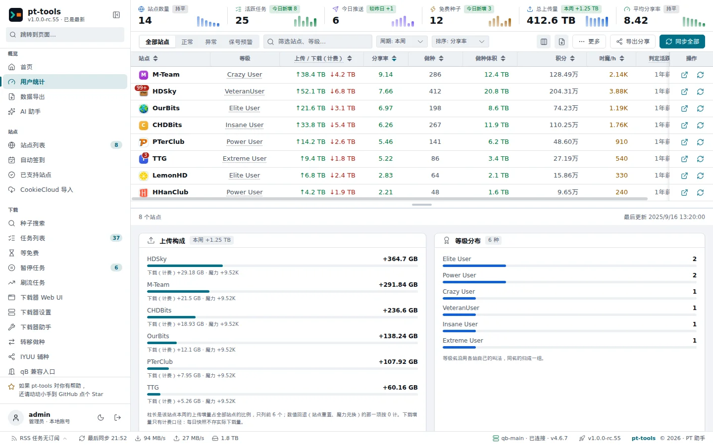

<div align="center">


# pt-tools

### PT 站点自动化：RSS 下载、刷流辅种、追剧入库、签到保号与数据统计

[](https://github.com/sunerpy/pt-tools/actions/workflows/ci.yml)
[](https://github.com/sunerpy/pt-tools/releases)
[](https://hub.docker.com/r/sunerpy/pt-tools)
[](https://codecov.io/gh/sunerpy/pt-tools)
[](./LICENSE)

[文档站](https://firlab.app/pt-tools/) · [1.0 亮点](#10-亮点) · [基础功能](#基础功能) · [安装](#安装) · [快速开始](#快速开始) · [用法](#用法) · [文档](#文档) · [开发](#开发)

[**简体中文**](./README.md) · [English](./docs/readme/README.en.md)

</div>

---

pt-tools 是自托管的 PT 站点管理工具：按 RSS 自动下载，刷流与 IYUU 辅种，订阅电影、追剧并整理进媒体库，每天签到、在封号前提醒，汇总各站点的数据，统一管理 qBittorrent 和 Transmission；手机 App、QQ、Telegram 与内置的 AI 助手都能查看和操作。内置 72 个站点，支持 Docker、Linux 和 Windows。完整文档在 **[firlab.app/pt-tools](https://firlab.app/pt-tools/)**。

<picture>
  <source media="(prefers-color-scheme: dark)" srcset="./docs/public/screens/home-dark.webp" />
  
</picture>

## 1.0 亮点

- **[追剧与媒体库](https://firlab.app/pt-tools/guide/media-subscribe)**：订阅电影、追剧集的一季，pt-tools 到各站点搜索并按质量档案挑资源，下载完按命名模板[整理进媒体库](https://firlab.app/pt-tools/guide/media-library)、刮削 NFO 与海报、通知 Emby、Jellyfin 或 Plex，每部片的[详情页与订阅日历](https://firlab.app/pt-tools/guide/media-detail)写明每一集入库了没有。
- **[刷流](https://firlab.app/pt-tools/guide/brush)与 [IYUU 辅种](https://firlab.app/pt-tools/guide/reseed)**：从站点的免费列表里按条件挑新种做种、按规则删种，收益按天统计；IYUU 找出其他站点上数据相同的种子，校验到 100% 才开始做种，数据只存一份。
- **[手机 App](https://firlab.app/pt-tools/guide/mobile-app)与[远程访问](https://firlab.app/pt-tools/guide/remote-access)**：Android App 扫网页上的二维码配对，先试直连、连不上再经 relay 连回 pt-tools，连接端到端加密，在外面也能看概览、管理种子与订阅。
- **[AI 助手](https://firlab.app/pt-tools/guide/assistant)与 [MCP](https://firlab.app/pt-tools/guide/mcp)**：接上 OpenAI 兼容的大模型，在网页、App、Telegram 或 QQ 里用自然语言查数据、搜索与推送种子、管理订阅，改动类操作每次都要你确认；Claude、Cursor 这类 MCP 客户端也能调用同一套工具。
- **[首页、NAS 监控与系统体检](https://firlab.app/pt-tools/guide/home-and-health)**：打开网页先到首页，上面是 NAS 的 CPU、内存、网络与存储（数据来自本机、TrueNAS、Glances 等[来源](https://firlab.app/pt-tools/guide/nas-monitor)）、今天播出的集与待处理的事；系统体检一次检查 TMDB、站点、下载器、媒体库、磁盘与备份，写明怎么修。
- **[通知通道与消息模板](https://firlab.app/pt-tools/guide/notify-channels)**：除了 QQ 和 Telegram，通知还能发到企业微信、钉钉、飞书群机器人、Bark、Server 酱、ntfy 与自定义 Webhook，每类事件的标题与正文都可以用模板改写。
- **[签到与封号提醒](https://firlab.app/pt-tools/guide/site-login-monitoring)**：按站点开启每日签到，验证码与签到题可以交给 AI；长期未登录、快要封号之前提醒你去登录。
- **[数据统计与分享图](https://firlab.app/pt-tools/guide/user-stats)**：每天存一份各站点的数据快照，按日、周、月看增量与走势，每日战报发到通知通道，统计可以[导出成分享图](https://firlab.app/pt-tools/guide/user-stats#导出分享图)（五种样式）。
- **[qB 兼容](https://firlab.app/pt-tools/guide/qbit-compat)与 [Servarr 兼容入口](https://firlab.app/pt-tools/guide/servarr)**：MoviePilot、IYUU、Sonarr 这类工具可以把 pt-tools 当成 qBittorrent（加的种子照常经过磁盘空间与做种容量的检查），Seerr 可以把它当成 Radarr 与 Sonarr，请求的电影与剧集建成订阅。

完整的变更见 [1.0 新功能](https://firlab.app/pt-tools/guide/whats-new-1.0)。

## 基础功能

- **站点与搜索**：72 个内置站点，覆盖 NexusPHP、mTorrent、Gazelle、HDDolby 和 Rousi 等架构，支持 Cookie、API Key 和 Passkey；在一个页面查看所有站点的上传量、分享率、做种、积分和等级进度；跨站点搜索的结果可以直接推送到下载器，也可以选一部电影或剧集按条目搜索。
- **RSS 自动下载**：定时拉取订阅，用关键词、通配符或正则过滤标题；免费期结束时没下完的种子按每条订阅的设置暂停或删除。
- **下载器**：可以添加多个 qBittorrent 和 Transmission，按 RSS 订阅、站点、默认下载器的顺序决定推送到哪一个；推送前检查剩余空间和站点做种容量，按做种时长、分享率等条件清理旧种子，并保护 H&R 种子；种子可以[转移](https://firlab.app/pt-tools/guide/torrent-transfer)到另一台下载器继续做种。
- **ChatOps**：在 QQ（OneBot）和 Telegram 里查看状态、暂停或删除种子、增删 RSS 订阅、追剧，每条命令都记入操作审计；RSS 上新通知支持静默时段、合并摘要、失败重试和每小时配额。
- **浏览器扩展**：[PT Tools Helper](tools/browser-extension/README.md) 一键或定时同步站点 Cookie，并采集脱敏后的页面数据，用于申请新增站点。
- **部署与维护**：Docker 镜像（amd64、arm64）与 Linux、Windows 二进制，1Panel、Unraid、飞牛 fnOS 上有应用定义；二进制部署可以在 Web 界面升级；每天定时备份数据库，可以在网页上恢复；访问站点和下载器可以走 HTTP、HTTPS 或 SOCKS5 代理，也可以只让选中的站点走代理。

> [!WARNING]
> RSS 未关联任何过滤规则时，pt-tools **只会下载免费种子**。追剧或下载特定的非免费资源时，请创建过滤规则并按需关闭「仅免费」。

## 安装

### Docker Compose（推荐）

```yaml
services:
  pt-tools:
    image: sunerpy/pt-tools:latest
    container_name: pt-tools
    environment:
      PT_HOST: "0.0.0.0"
      PT_PORT: "8080"
      TZ: "Asia/Shanghai"
    ports:
      - "8080:8080"
    volumes:
      - ./data:/app/.pt-tools
    restart: unless-stopped
    logging:
      driver: json-file
      options:
        max-size: "10m"
        max-file: "3"
```

保存为 `compose.yml` 后运行 `docker compose up -d`。镜像同时发布在 Docker Hub（`sunerpy/pt-tools`）和 GHCR（`ghcr.io/sunerpy/pt-tools`），都包含 amd64 与 arm64。1Panel、Unraid 与飞牛 fnOS 的安装方法见[安装](https://firlab.app/pt-tools/guide/install#nas)。

> [!IMPORTANT]
> 必须持久化 `/app/.pt-tools`。这个目录里有数据库、配置和用来加密站点凭证的 `secret.key`；密钥丢失后，已保存的 Cookie 无法恢复。

### 安装脚本

```bash
# Linux
curl -fsSL https://raw.githubusercontent.com/sunerpy/pt-tools/main/scripts/install.sh | sh
```

```powershell
# Windows PowerShell
irm https://raw.githubusercontent.com/sunerpy/pt-tools/main/scripts/install.ps1 | iex
```

脚本会下载最新版本的压缩包和同一版本的 `checksums.txt`，SHA-256 不一致时拒绝安装。用 `TOOL_VERSION` 指定版本（例如 `TOOL_VERSION=v1.0.0`），Linux 上用 `TOOL_INSTALL_DIR` 指定安装目录（默认 `~/.local/bin`）。

### 预编译二进制

从 [Releases](https://github.com/sunerpy/pt-tools/releases) 下载。每个版本都附带 `checksums.txt` 和构建来源证明，`gh attestation verify` 的用法写在每个 Release 的说明里：

| 系统    | 架构  | 文件                             |
| ------- | ----- | -------------------------------- |
| Linux   | amd64 | `pt-tools-linux-amd64.tar.gz`    |
| Linux   | arm64 | `pt-tools-linux-arm64.tar.gz`    |
| Windows | amd64 | `pt-tools-windows-amd64.exe.zip` |
| Windows | arm64 | `pt-tools-windows-arm64.exe.zip` |

解压后运行 `pt-tools web --host 0.0.0.0 --port 8080`。没有 macOS 二进制，macOS 请使用 Docker。systemd 服务、Windows 与更多 Docker 示例见[安装](https://firlab.app/pt-tools/guide/install)、[二进制运行指南](examples/binary-run.md)和[Docker 示例](examples/docker-run.md)。

Android App 的安装包（大多数手机用 `pt-tools-app-arm64-v8a.apk`）在同一个 Release 里，版本号与服务端相同，见[手机 App](https://firlab.app/pt-tools/guide/mobile-app)。

### 从源码构建

需要 Go `1.26.10`、Node.js `25.2.0` 和 pnpm `10.25.0`，运行 `make build-local`，详见[开发指南](docs/development.md)。

## 快速开始

1. 打开 <http://localhost:8080>，用初始账号 `admin` / `adminadmin` 登录，并立即在「系统 → 修改密码」中修改密码。
2. 在「下载 → 下载器设置」中添加 qBittorrent 或 Transmission，并检查连通性。
3. 在「站点 → 站点列表」中添加站点认证：Cookie 站点用 [PT Tools Helper](tools/browser-extension/README.md) 同步，API Key 和 Passkey 站点按[获取 Cookie 与 API Key](https://firlab.app/pt-tools/guide/get-cookie-apikey) 填写。
4. 在站点的「RSS 订阅」分页中添加订阅，选好下载器、下载路径和免费结束时没下完的处理方式。没有关联过滤规则时只下载免费种子。
5. 点底部状态栏的「RSS 任务」启动，并在同一个面板里打开「程序启动时自动运行」。
6. 备份 `secret.key`，并确认数据目录已有外部备份。

逐步说明见文档站的[快速开始](https://firlab.app/pt-tools/guide/quick-start)，那里还写了追剧、手机 App 与 AI 助手的第一步。

## 用法

- **Web 界面**：站点、RSS、过滤规则、下载器、媒体库、自动清理和通知都在 Web 界面里配置；手机浏览器里同样的页面以卡片显示。
- **ChatOps**：QQ 和 Telegram 支持 `/help`、`/status`、`/version`、`/tasks`、`/sites`、`/torrents`、`/pause`、`/resume`、`/delete`、`/signin`、`/addrss`、`/delrss`，订阅与追剧的 `/sub`、`/follow`、`/subs`、`/runs`、`/today`、`/unlock`，AI 助手的 `/newchat`，以及 `/bind` 和 `/unbind`。通道的两栏名单决定谁能与机器人对话；用绑定码完成绑定的账号都能执行管理命令，所以绑定码只发给信任的人。见 [ChatOps 快速开始](https://firlab.app/pt-tools/guide/chatops-quickstart)。
- **命令行**：`pt-tools web` 启动服务，`pt-tools db backup`、`pt-tools db restore` 备份与恢复数据，`pt-tools secret` 导出、导入加密密钥，`pt-tools clean` 预览并清理已轮转的日志、暂存种子和旧备份，`pt-tools mcp` 把 MCP 工具接给只支持 stdio 的客户端，`pt-tools relay serve` 自己运行远程访问的 relay，见[命令行](https://firlab.app/pt-tools/reference/cli)。

## 文档

文档站 **[firlab.app/pt-tools](https://firlab.app/pt-tools/)**（中文，[English](https://firlab.app/pt-tools/en/)）的内容来自本仓库的 `docs/` 目录，在 GitHub 上也可以从[文档中心](docs/README.md)按主题浏览。

| 文档                                                                          | 内容                                    |
| ----------------------------------------------------------------------------- | --------------------------------------- |
| [pt-tools 是什么](https://firlab.app/pt-tools/guide/what-is-pt-tools)         | 工作方式与界面各页的用途                |
| [1.0 新功能](https://firlab.app/pt-tools/guide/whats-new-1.0)                 | 1.0 加入的功能与重要修复                |
| [安装](https://firlab.app/pt-tools/guide/install)                             | Docker、NAS、二进制、systemd 与首次登录 |
| [配置说明](https://firlab.app/pt-tools/configuration)                         | 环境变量、代理、下载器、持久化与日志    |
| [RSS 订阅](https://firlab.app/pt-tools/guide/rss-subscription)                | 订阅、下载器选择、免费结束策略          |
| [过滤规则与追剧](https://firlab.app/pt-tools/guide/filter-rules-tv-series)    | 关键词、通配符与正则规则                |
| [自动删种与磁盘保护](https://firlab.app/pt-tools/guide/auto-cleanup)          | 清理条件、H&R 保护与剩余空间检查        |
| [登录状态与密钥备份](https://firlab.app/pt-tools/guide/site-login-monitoring) | 登录探测、封号提醒、每日签到与密钥备份  |
| [ChatOps](https://firlab.app/pt-tools/guide/chatops-quickstart)               | QQ、Telegram、绑定与 RSS 上新通知       |
| [升级与备份](https://firlab.app/pt-tools/guide/upgrade)                       | 各安装方式的升级、备份与恢复            |
| [数据与安全](https://firlab.app/pt-tools/reference/security)                  | 数据位置、加密范围、外连与部署建议      |
| [支持站点](https://firlab.app/pt-tools/sites)                                 | 72 个内置站点及认证方式                 |
| [请求新增站点](https://firlab.app/pt-tools/guide/request-new-site)            | 用扩展采集并脱敏提交站点数据            |
| [常见问题](https://firlab.app/pt-tools/faq)                                   | 认证、RSS、下载器与数据库排障           |

每个版本的功能、修复和升级说明见 [Releases](https://github.com/sunerpy/pt-tools/releases) 与 [CHANGELOG](CHANGELOG.md)。

## 开发

仓库固定使用 Go `1.26.10`、Node.js `25.2.0` 和 pnpm `10.25.0`。克隆后运行完整的本地门禁：

```bash
make check
```

常用目标：

```bash
make fmt             # Go 与前端格式化
make lint            # Go、前端 lint 与类型检查
make test            # 前端构建与单测，Go race 测试
make docs-check      # 仓库内 Markdown 的相对链接与锚点
make build-local     # 构建前端和当前平台的二进制
make build-extension # 校验站点并打包浏览器扩展
```

贡献前请阅读[开发指南](docs/development.md)和仓库根目录的 `AGENTS.md`。提交与 PR 标题遵循 Conventional Commits；新增站点只在 `site/v2/definitions/` 添加定义，并补齐 fixture 测试。文档站的写作约定与上线流程见 [docs/README.md](docs/README.md)。

## 社区

- [GitHub Issues](https://github.com/sunerpy/pt-tools/issues)
- [GitHub Discussions](https://github.com/sunerpy/pt-tools/discussions)
- [Telegram](https://t.me/+7YK2kmWIX0s1Nzdl)
- QQ 群：`274984594`
- 微信公众号：六月水蓝，微信扫描下方二维码关注


## 许可证

[MIT License](LICENSE)

---

**免责声明**：本工具仅供学习和研究使用。请遵守各 PT 站点的规则，并自行评估自动化访问的风险。
