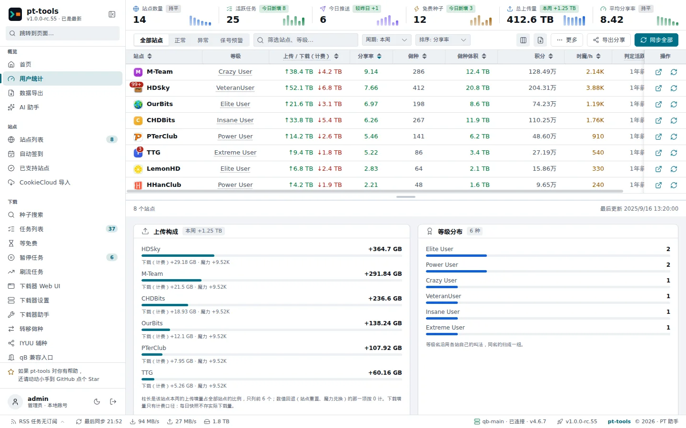

<div align="center">


# pt-tools

### Private tracker automation: RSS downloads, seed boosting and cross-seeding, following shows into your library, check-in and statistics

[](https://github.com/sunerpy/pt-tools/actions/workflows/ci.yml)
[](https://github.com/sunerpy/pt-tools/releases)
[](https://hub.docker.com/r/sunerpy/pt-tools)
[](https://codecov.io/gh/sunerpy/pt-tools)
[](../../LICENSE)

[Documentation](https://firlab.app/pt-tools/en/) · [1.0 highlights](#10-highlights) · [Core features](#core-features) · [Install](#install) · [Quick start](#quick-start) · [Usage](#usage) · [Docs](#docs) · [Development](#development)

[简体中文](../../README.md) · [**English**](./README.en.md)

</div>

---

pt-tools is a self-hosted manager for private trackers. It downloads from your RSS feeds, boosts your ratio and cross-seeds with IYUU, subscribes to films and follows series into your media library, checks in daily and reminds you before an inactive account is disabled, collects every site's statistics, and manages qBittorrent and Transmission in one place; the mobile app, QQ, Telegram and the built-in AI assistant can all check on it and act. It supports 67 sites out of the box and runs in Docker, on Linux and on Windows. The full documentation is at **[firlab.app/pt-tools/en](https://firlab.app/pt-tools/en/)**.

The web interface is in Chinese; the screenshot below shows it with demo data.

<picture>
  <source media="(prefers-color-scheme: dark)" srcset="../public/screens/home-dark.webp" />
  
</picture>

## 1.0 highlights

- **[Following and the media library](https://firlab.app/pt-tools/en/guide/media-subscribe)**: subscribe to a film or follow one season of a series, and pt-tools searches your sites and picks releases by your quality profile; finished downloads are [filed into your library](https://firlab.app/pt-tools/en/guide/media-library) by naming templates with NFO files and posters, Emby, Jellyfin or Plex is told to scan, and each title's [details page and the subscription calendar](https://firlab.app/pt-tools/en/guide/media-detail) show which episodes are in the library.
- **[Seed boosting](https://firlab.app/pt-tools/en/guide/brush) and [IYUU cross-seeding](https://firlab.app/pt-tools/en/guide/reseed)**: pick fresh torrents from a site's free list by your conditions, delete them by rules and track the earnings per day; IYUU finds torrents with the same data on other sites, which start seeding only after a 100 % check, with the data stored once.
- **[Mobile app](https://firlab.app/pt-tools/en/guide/mobile-app) and [remote access](https://firlab.app/pt-tools/en/guide/remote-access)**: the Android app pairs by scanning a QR code in the web interface and connects back directly or, failing that, through a relay, end-to-end encrypted, so you can see the overview and manage torrents and subscriptions away from home.
- **[AI assistant](https://firlab.app/pt-tools/en/guide/assistant) and [MCP](https://firlab.app/pt-tools/en/guide/mcp)**: connect an OpenAI-compatible model and ask about your data, search for and push torrents and manage subscriptions in plain language on the web, in the app, or in Telegram or QQ, with every change waiting for your confirmation; MCP clients such as Claude and Cursor can use the same tools.
- **[Home page, NAS monitoring and system check](https://firlab.app/pt-tools/en/guide/home-and-health)**: the web interface opens on a home page with your NAS's CPU, memory, network and storage (from the local host, TrueNAS, Glances and other [sources](https://firlab.app/pt-tools/en/guide/nas-monitor)), the episodes airing today and the things that need attention; the system check tests TMDB, sites, downloaders, media libraries, disks and backups in one go and says how to fix each problem.
- **[Notification channels and message templates](https://firlab.app/pt-tools/en/guide/notify-channels)**: besides QQ and Telegram, notifications can go to WeCom, DingTalk and Feishu group bots, Bark, ServerChan, ntfy and custom webhooks, and the title and body of each kind of event can be rewritten with templates.
- **[Check-in and inactivity reminders](https://firlab.app/pt-tools/en/guide/site-login-monitoring)**: turn on daily sign-in per site, with captchas and quiz questions handed to AI, and get a reminder to sign in before an inactive account is disabled.
- **[Statistics and share images](https://firlab.app/pt-tools/en/guide/user-stats)**: a daily snapshot of every site gives daily, weekly and monthly increments and trends, a daily report goes to your notification channels, and the statistics can be [exported as a share image](https://firlab.app/pt-tools/en/guide/user-stats#exporting-a-share-image) in five styles.
- **[qB-compatible](https://firlab.app/pt-tools/en/guide/qbit-compat) and [Servarr-compatible entrances](https://firlab.app/pt-tools/en/guide/servarr)**: tools such as MoviePilot, IYUU and Sonarr can treat pt-tools as qBittorrent (the torrents they add still go through the free-space and seeding-capacity checks), and Seerr can treat it as Radarr and Sonarr, with its requests becoming subscriptions.

Everything that changed is in [What's new in 1.0](https://firlab.app/pt-tools/en/guide/whats-new-1.0).

## Core features

- **Sites and search**: 67 built-in sites on NexusPHP, mTorrent, Gazelle, HDDolby, Rousi and other platforms, signed in with a cookie, an API key or a passkey. One page shows upload, download, ratio, seeding, bonus points and class progress for every site; search several sites at once and push results straight to a downloader, or pick a film or series and search by title.
- **RSS downloads**: feeds are fetched on a schedule, and filter rules match titles with keywords, wildcards or regular expressions. A torrent still downloading when its free period ends is paused or deleted, as its feed is set.
- **Downloaders**: add several qBittorrent and Transmission instances; a torrent goes to the one bound to its RSS feed, then its site, then the default. Free space and the site's seeding capacity are checked before every push, old torrents are removed by seeding time, ratio and other conditions with H&R torrents kept, and torrents can be [transferred](https://firlab.app/pt-tools/en/guide/torrent-transfer) to another downloader to keep seeding.
- **ChatOps**: from QQ (OneBot) or Telegram, check status, pause or delete torrents, add or remove RSS feeds and follow shows, with every command in the audit log. New-torrent notifications support quiet hours, digests, retries and an hourly limit.
- **Browser extension**: [PT Tools Helper](../../tools/browser-extension/README.md) syncs site cookies in one click or on a schedule and collects redacted pages to request support for a new site.
- **Deployment and upkeep**: a Docker image (amd64 and arm64), binaries for Linux and Windows, and app definitions for 1Panel, Unraid and fnOS; the binary upgrades itself from the web interface; the database is backed up daily and can be restored from the web interface; sites and downloaders can be reached through an HTTP, HTTPS or SOCKS5 proxy, for all sites or only the ones you choose.

> [!WARNING]
> An RSS feed without any filter rule downloads **freeleech torrents only**. To follow a series or download particular non-free torrents, create a filter rule and turn off "free only" (仅免费) where needed.

## Install

### Docker Compose (recommended)

```yaml
services:
  pt-tools:
    image: sunerpy/pt-tools:latest
    container_name: pt-tools
    environment:
      PT_HOST: "0.0.0.0"
      PT_PORT: "8080"
      TZ: "Asia/Shanghai"
    ports:
      - "8080:8080"
    volumes:
      - ./data:/app/.pt-tools
    restart: unless-stopped
    logging:
      driver: json-file
      options:
        max-size: "10m"
        max-file: "3"
```

Save it as `compose.yml` and run `docker compose up -d`. The image is published on Docker Hub (`sunerpy/pt-tools`) and GHCR (`ghcr.io/sunerpy/pt-tools`), for amd64 and arm64. For 1Panel, Unraid and fnOS, see [Install](https://firlab.app/pt-tools/en/guide/install#nas).

> [!IMPORTANT]
> Keep `/app/.pt-tools` on a volume. It holds the database, the settings and the `secret.key` that encrypts site credentials; if the key is lost, saved cookies cannot be recovered.

### Install script

```bash
# Linux
curl -fsSL https://raw.githubusercontent.com/sunerpy/pt-tools/main/scripts/install.sh | sh
```

```powershell
# Windows PowerShell
irm https://raw.githubusercontent.com/sunerpy/pt-tools/main/scripts/install.ps1 | iex
```

The script downloads the latest archive together with the same release's `checksums.txt` and refuses to install when the SHA-256 does not match. Set `TOOL_VERSION` for a particular version (for example `TOOL_VERSION=v1.0.0`) and, on Linux, `TOOL_INSTALL_DIR` for the install folder (default `~/.local/bin`).

### Prebuilt binaries

Download from [Releases](https://github.com/sunerpy/pt-tools/releases). Every release includes `checksums.txt` and build provenance attestations; each release's notes show how to check them with `gh attestation verify`:

| OS      | Architecture | File                             |
| ------- | ------------ | -------------------------------- |
| Linux   | amd64        | `pt-tools-linux-amd64.tar.gz`    |
| Linux   | arm64        | `pt-tools-linux-arm64.tar.gz`    |
| Windows | amd64        | `pt-tools-windows-amd64.exe.zip` |
| Windows | arm64        | `pt-tools-windows-arm64.exe.zip` |

Unpack it and run `pt-tools web --host 0.0.0.0 --port 8080`. There is no macOS binary; on macOS, use Docker. For a systemd service, Windows and more Docker examples, see [Install](https://firlab.app/pt-tools/en/guide/install), the [binary guide](../../examples/binary-run.md) and the [Docker examples](../../examples/docker-run.md).

The Android app (most phones need `pt-tools-app-arm64-v8a.apk`) is in the same release and has the same version number as the server; see [Mobile app](https://firlab.app/pt-tools/en/guide/mobile-app).

### Build from source

With Go `1.26.10`, Node.js `25.2.0` and pnpm `10.25.0`, run `make build-local`; see the [development guide](../development.md) (in Chinese).

## Quick start

1. Open <http://localhost:8080>, sign in with the initial account `admin` / `adminadmin`, and change the password straight away under System → Change password (系统 → 修改密码).
2. In Downloads → Downloader settings (下载 → 下载器设置), add qBittorrent or Transmission and check that it connects.
3. In Sites → Site list (站点 → 站点列表), sign in to your sites: sync cookies with [PT Tools Helper](../../tools/browser-extension/README.md), and enter API keys or passkeys as described in [Cookies and API keys](https://firlab.app/pt-tools/en/guide/get-cookie-apikey).
4. On the site's RSS subscriptions (RSS 订阅) tab, add a feed and choose its downloader, download folder and what happens to a torrent still downloading when freeleech ends. Without filter rules it downloads freeleech torrents only.
5. Click RSS tasks (RSS 任务) in the status bar at the bottom to start them, and in the same panel turn on Start when the program starts (程序启动时自动运行).
6. Back up `secret.key`, and make sure the data folder is backed up elsewhere.

The [quick start](https://firlab.app/pt-tools/en/guide/quick-start) on the documentation site walks through each step and gives the first steps for following shows, the mobile app and the AI assistant.

## Usage

- **Web interface**: sites, RSS feeds, filter rules, downloaders, media libraries, auto-delete and notifications are all set up in the web interface; in a phone's browser the same pages are shown as cards.
- **ChatOps**: QQ and Telegram accept `/help`, `/status`, `/version`, `/tasks`, `/sites`, `/torrents`, `/pause`, `/resume`, `/delete`, `/signin`, `/addrss` and `/delrss`; `/sub`, `/follow`, `/subs`, `/runs`, `/today` and `/unlock` for subscriptions and followed shows; `/newchat` for the AI assistant; and `/bind` and `/unbind`. A channel's two user lists decide who can talk to the bot; every account linked with a binding code can run the management commands, so give binding codes only to people you trust. See the [ChatOps quick start](https://firlab.app/pt-tools/en/guide/chatops-quickstart).
- **Command line**: `pt-tools web` starts the service, `pt-tools db backup` and `pt-tools db restore` back up and restore the data, `pt-tools secret` exports and imports the encryption key, `pt-tools clean` previews and removes rotated logs, staged torrent files and old backups, `pt-tools mcp` connects the MCP tools to clients that only speak stdio, and `pt-tools relay serve` runs your own relay for remote access; see the [command line](https://firlab.app/pt-tools/en/reference/cli) reference.

## Docs

The documentation site **[firlab.app/pt-tools/en](https://firlab.app/pt-tools/en/)** ([中文](https://firlab.app/pt-tools/)) is built from this repository's `docs/` folder.

| Page                                                                                      | What it covers                                                 |
| ----------------------------------------------------------------------------------------- | -------------------------------------------------------------- |
| [What is pt-tools](https://firlab.app/pt-tools/en/guide/what-is-pt-tools)                 | How it works and what each page of the interface is for        |
| [What's new in 1.0](https://firlab.app/pt-tools/en/guide/whats-new-1.0)                   | Features and important fixes added in 1.0                      |
| [Install](https://firlab.app/pt-tools/en/guide/install)                                   | Docker, NAS, binaries, systemd and the first sign-in           |
| [Configuration](https://firlab.app/pt-tools/en/configuration)                             | Environment variables, proxies, downloaders, storage           |
| [RSS subscriptions](https://firlab.app/pt-tools/en/guide/rss-subscription)                | Feeds, downloader choice, what happens when free ends          |
| [Filter rules and TV series](https://firlab.app/pt-tools/en/guide/filter-rules-tv-series) | Keyword, wildcard and regular-expression rules                 |
| [Auto-delete and disk protection](https://firlab.app/pt-tools/en/guide/auto-cleanup)      | Cleanup conditions, H&R protection, free-space checks          |
| [Login status and key backup](https://firlab.app/pt-tools/en/guide/site-login-monitoring) | Login checks, inactivity reminders, daily sign-in, key backups |
| [ChatOps](https://firlab.app/pt-tools/en/guide/chatops-quickstart)                        | QQ, Telegram, binding and new-torrent notifications            |
| [Upgrades and backups](https://firlab.app/pt-tools/en/guide/upgrade)                      | Upgrading, backing up and restoring each install               |
| [Data and security](https://firlab.app/pt-tools/en/reference/security)                    | Where data lives, encryption, outbound connections             |
| [Supported sites](https://firlab.app/pt-tools/en/sites)                                   | The 67 built-in sites and how each signs in                    |
| [Requesting a new site](https://firlab.app/pt-tools/en/guide/request-new-site)            | Collecting and submitting redacted site data                   |
| [FAQ](https://firlab.app/pt-tools/en/faq)                                                 | Sign-in, RSS, downloader and database problems                 |

Features, fixes and upgrade notes for each version are in [Releases](https://github.com/sunerpy/pt-tools/releases) and the [CHANGELOG](../../CHANGELOG.md) (in Chinese).

## Development

The repository pins Go `1.26.10`, Node.js `25.2.0` and pnpm `10.25.0`. After cloning, run the full local gate:

```bash
make check
```

Common targets:

```bash
make fmt             # format Go and the frontend
make lint            # Go and frontend lint plus type checks
make test            # frontend build and tests, Go race tests
make docs-check      # relative links and anchors in the repository's Markdown
make build-local     # build the frontend and a binary for this platform
make build-extension # check the site list and package the browser extension
```

Before contributing, read the [development guide](../development.md) (in Chinese) and `AGENTS.md` at the repository root. Commits and pull request titles follow Conventional Commits; a new site is added only as a definition under `site/v2/definitions/`, with fixture tests. The writing rules and publishing flow for the documentation site are in [docs/README.md](../README.md) (in Chinese).

## Community

- [GitHub Issues](https://github.com/sunerpy/pt-tools/issues)
- [GitHub Discussions](https://github.com/sunerpy/pt-tools/discussions)
- [Telegram](https://t.me/+7YK2kmWIX0s1Nzdl)
- QQ group: `274984594`
- WeChat Official Account: 六月水蓝 (scan the QR code below with WeChat to follow)


## License

[MIT License](../../LICENSE)

---

**Disclaimer**: this tool is for learning and research. Follow each site's rules, and judge the risks of automated access for yourself.
